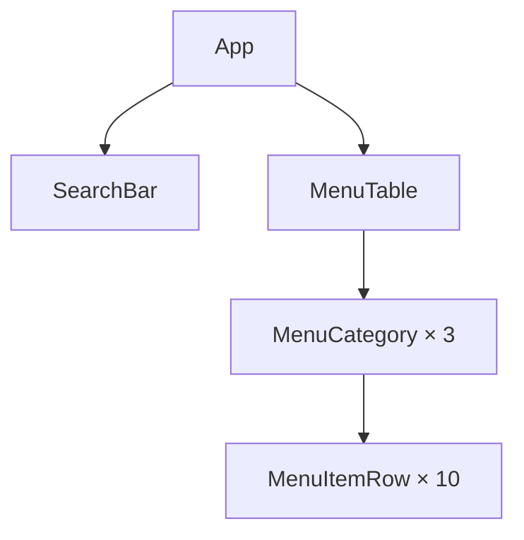

# ЛР-3. Рефакторинг за деревом компонентів

Стартовий проєкт лабораторної роботи № 3 курсу «Розробка вебзастосунків на
React»: сторінка «Меню кав'ярні». Інструкція:
https://denysmatsevych.github.io/web-development-2026/react/labs/lab-3/

Застосунок уже працює, але весь він — один компонент `App` у `src/App.jsx`.
Ви розкладете його на компоненти в теці `src/components/`, не змінивши
сторінки. Дані меню лежать у `src/data.js`, стилі — у `src/index.css`.

## Команди

`npm install` виконуйте в корені репозиторію `react-labs`, решту — у теці
`lab-3/`:

- `npm run dev`: dev-сервер на http://localhost:5173
- `npm run lint`: ESLint
- `npm run format:check`: перевірка форматування Prettier
- `npm run build`: production-збірка в `dist/`

## Ієрархія компонентів

Допишіть діаграму Mermaid за макетом із рамками (§4.2), а після рефакторингу
звірте її з вкладкою **Components ⚛** у React DevTools (§4.7). GitHub
показує цей блок діаграмою; перевірити її до `git push` можна в
https://mermaid.live/.

## Стан

Для кожного рядка таблиці дайте відповідь на три питання з кроку 3 Thinking in
React (§4.7):

1. Чи залишаються ці дані незмінними з часом? Якщо так, це не стан.
2. Чи передаються вони від батьківського компонента через пропси? Якщо так, це
   не стан.
3. Чи можна обчислити їх на основі наявного стану чи пропсів? Якщо так, це
   точно не стан.

| Дані                                           | Стан? | Чому                                                                 |
| ---------------------------------------------- | ----- | -------------------------------------------------------------------- |
| меню: категорії й позиції (`menu`)             | ні    | Це незмінні дані, які App передає дочірнім компонентам через пропси. |
| текст у полі пошуку                            | так   | Він змінюється, коли користувач вводить текст, і не обчислюється.    |
| значення прапорця «Лише в наявності»           | так   | Воно змінюється користувачем і не походить з інших даних.            |
| позиції, що залишаться після фільтрування      | ні    | Їх можна обчислити з menu, тексту пошуку та значення прапорця.       |
| кількість позицій у заголовку категорії, «(4)» | ні    | Її можна обчислити з довжини списку відфільтрованих позицій.         |

Стан житиме в компоненті: `App`, бо `SearchBar` показуватиме й змінюватиме
текст пошуку та значення прапорця, а `MenuTable` використовуватиме їх для
фільтрування. `App` є їхнім найближчим спільним батьківським компонентом.
